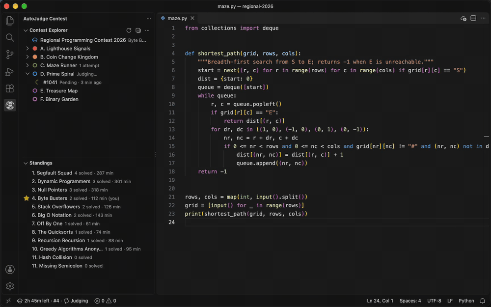
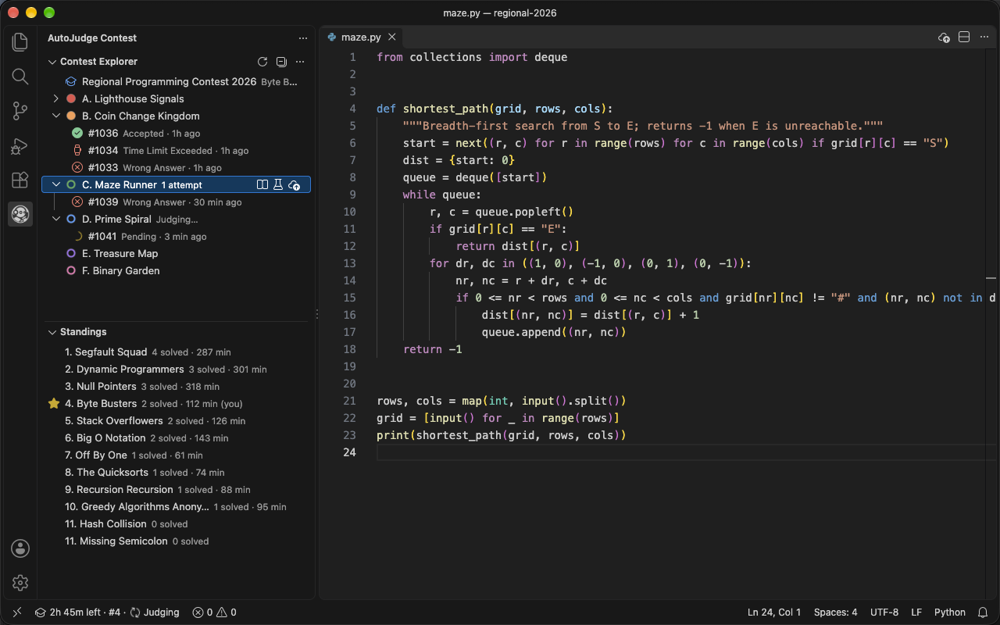
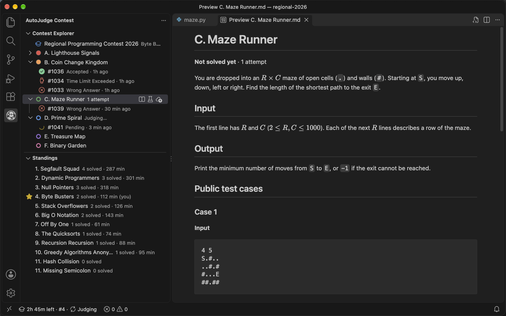
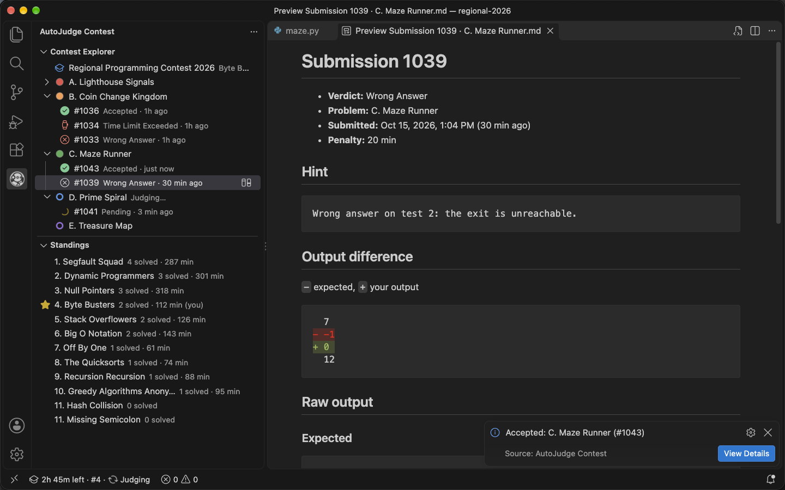
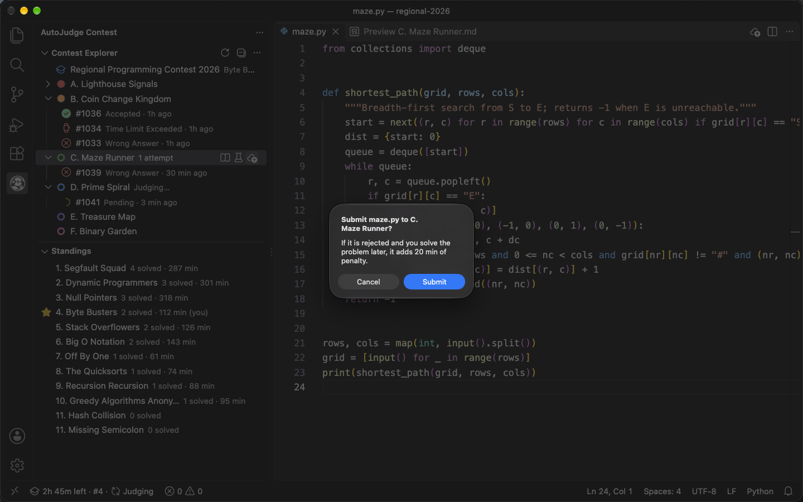

# AutoJudge Contest

Compete in AutoJudge programming contests without leaving VS Code: read the problems, test locally, submit, and follow your verdicts and the scoreboard from the editor.

<p align="center">
  
</p>

## Why use it

- **Read problems in VS Code.** Statements open as Markdown pages next to your code, with each public test case in a copyable block.
- **Test with the official samples.** Export a problem's public tests as `.in` / `.out` files beside your solution in one click.
- **Submit safely.** Submit the file you are editing, pick the problem from a short list, and confirm before it goes to the judge.
- **See why you got Wrong Answer.** Verdicts arrive as notifications, and the submission page shows an inline diff of the expected output against yours.
- **Keep an eye on the clock.** The status bar shows the time left, your rank, and how many submissions are being judged.
- **Follow the live scoreboard.** The Standings view ranks every team and stars yours.

## Features

### Contest Explorer, Standings, and the status bar

<p align="center">
  
</p>

- Problems are listed by letter (**A.**, **B.**, …). A filled balloon marks a solved problem and a hollow ring one you have not solved yet, with your attempt count beside it.
- Each problem lists its own submissions, newest first, with the verdict and how long ago it was sent. A pending submission shows a spinning **Judging…** label until the verdict arrives.
- **Standings** ranks teams by solved problems, then by lowest total time. Your team is starred and marked `(you)`. A notice appears while the scoreboard is frozen. Click a team to see its solved problems and total time.
- The status bar shows `time left · #rank · Judging`, turns to a warning colour in the last 15 minutes, and opens the **Contest Overview** page when clicked.

### Problem statements and public test cases

<p align="center">
  
</p>

- Click the **book** icon on a problem to open its statement as a Markdown page. Every public test case is a numbered Input / Output block you can copy.
- Click the **beaker** icon to export the public tests as `<problem>-testcase-01.in` / `.out` files in the active file's folder (or the only workspace folder, or a folder you choose). Existing files are replaced only after you confirm, and you can open the first case straight away.

### Verdicts with an output diff

<p align="center">
  
</p>

- Each verdict arrives as a notification with **View Details**, plus **Compare Output** when the judge reported both the expected and the received output.
- The submission page shows the verdict, time or penalty, the judge's hint, and an inline diff of expected versus your output, followed by the raw outputs.
- **Compare Output** opens the same comparison in VS Code's side-by-side diff editor.
- Submissions still being judged keep being checked, even after you restart VS Code.

### Submitting

<p align="center">
  
</p>

- Submit from the **cloud upload** icon on a problem row, from the same icon in the editor title bar, or with **AutoJudge Contest: Submit Active File…**.
- The picker lists the problem you last submitted that file to first, and leaves out problems you have already solved.
- A confirmation dialog shows the file and problem before anything is sent. Turn it off with `autojudgeContest.confirmBeforeSubmit` (unsaved files are always confirmed before they are saved and submitted).
- The new submission appears under its problem as **Judging…**, and a second submission is refused until the first has reached the judge.

## Getting started

1. Click the **AutoJudge Contest** icon in the Activity Bar.
2. Click **Log In with Browser**. Your browser opens the AutoJudge team login: enter the **team code** and **PIN** from your team card (or confirm the session you are already logged in with), then allow the browser to open VS Code.
3. Back in VS Code, the **Contest Explorer** lists the problems. Before the start it shows **Contest has not started yet**, and the problems load on their own when the contest begins.
4. Open a problem with the **book** icon, export its tests with the **beaker** icon, write your solution, and submit it with the **cloud upload** icon.

Your session lasts the whole contest and is restored when VS Code restarts. Log in again if contest staff reset your PIN or another login replaces it.

> [!NOTE]
> Log in with a single VS Code window open. The browser hands the login back to whichever window VS Code chooses, which may not be the one that started it.

## Commands

All commands are in the **AutoJudge Contest** category of the Command Palette.

| Command | What it does |
| :--- | :--- |
| **Log In** | Opens the browser login and connects VS Code to your team session. |
| **Log Out** | Forgets the session on this computer (the team session stays active on the server). Also in the `…` menu of both views. |
| **Refresh** | Reloads the contest, problems, submissions, and standings. |
| **Open Contest Overview** | Opens the contest's phase, schedule, rules, and your team's position. |
| **Open Problem Statement** | Opens a problem statement. Asks which problem when run from the Command Palette. |
| **Submit Active File…** | Submits the active source file to a problem you pick. |
| **Export Public Test Cases** | Writes a problem's public tests as `.in` / `.out` files. |
| **Open Submission** | Opens a submission's details. Contest Explorer only. |
| **Open Team Details** | Opens a team's rank, solved problems, and total time. Standings only. |
| **Compare Expected and Received Output** | Opens a side-by-side diff of a submission's expected and received output. Contest Explorer only. |

## Settings

| Setting | Default | Description |
| :--- | :--- | :--- |
| `autojudgeContest.baseUrl` | `https://api.autojudge.io` | AutoJudge API address. Base paths such as `https://example.com/api` are supported. |
| `autojudgeContest.webUrl` | `https://autojudge.io` | AutoJudge website opened for the browser login. |
| `autojudgeContest.pollIntervalMs` | `5000` | How often, in milliseconds, a pending submission is checked for its verdict (minimum `1000`). |
| `autojudgeContest.confirmBeforeSubmit` | `true` | Ask for confirmation before submitting the active file. |

`baseUrl` and `webUrl` are application-scoped (set them in your user settings) and take effect without reloading the window. The Standings view refreshes every 15 seconds while visible and every 60 seconds while hidden.

## Supported languages

`.c`, `.cpp`, `.java`, `.js`, `.php`, and `.py` source files.

## Requirements

- VS Code 1.90 or later.
- A team in a running AutoJudge contest, on [autojudge.io](https://autojudge.io) or on a self-hosted [AutoJudge](https://github.com/werlang/autojudge) server.

## Privacy and security

- You never type your team code or PIN into VS Code. The login happens on the AutoJudge website, which hands VS Code a session.
- The session token is stored in VS Code's SecretStorage (your operating system's credential store) and is never written to settings, files, or the output log.
- **Log Out** removes the token from this computer.

## Run your tests locally

Pair this extension with [AutoJudge Code Runner](https://marketplace.visualstudio.com/items?itemName=autojudge.autojudge-extension) to compile, run, and check your solution against the exported test cases without leaving the editor.

## Self-hosted contests

AutoJudge is open source: [werlang/autojudge](https://github.com/werlang/autojudge). To use your own server, set `autojudgeContest.baseUrl` to its API address and `autojudgeContest.webUrl` to its website address in your user settings. An invalid address is reported with an **Open Settings** button as soon as the extension needs the server, including when you start **Log In**.

## Contributing

Issues and pull requests are welcome on [GitHub](https://github.com/werlang/autojudge-contest/issues). Development runs in Docker Compose:

```bash
docker compose up -d --build
docker compose exec extension npm install
docker compose exec extension npm test
docker compose exec extension npm run build   # package the .vsix
```

Press `F5` in VS Code to launch the Extension Development Host.

## License

[MIT](LICENSE)
